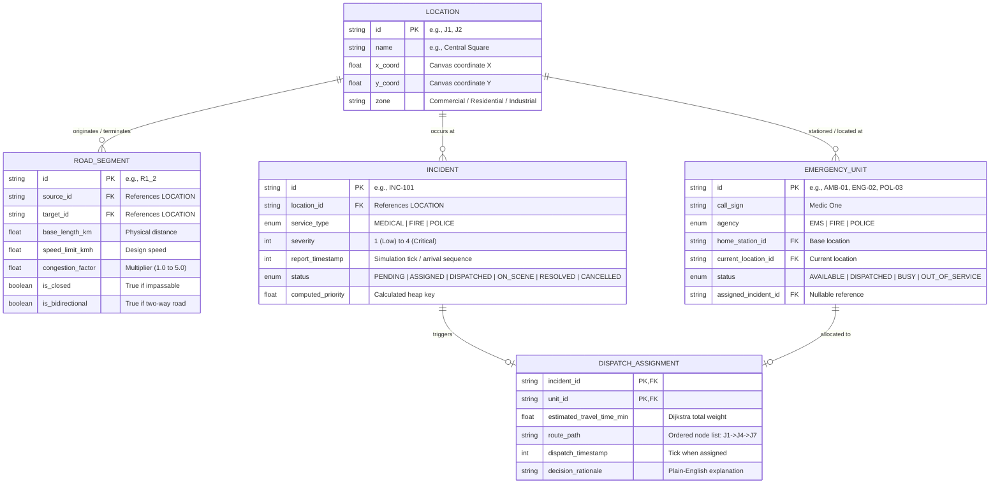
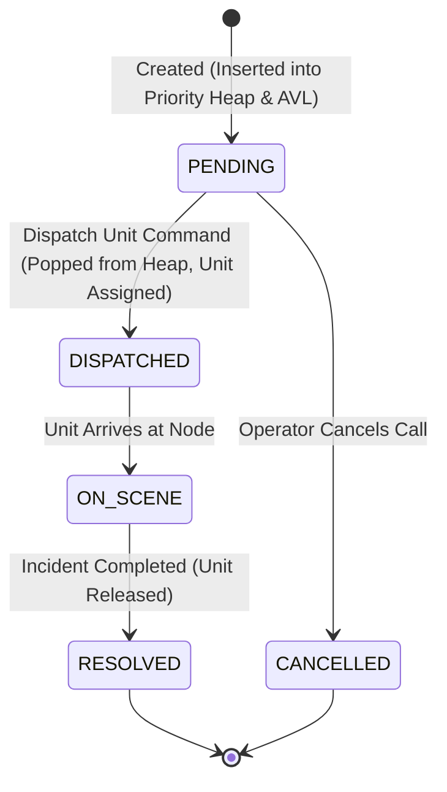
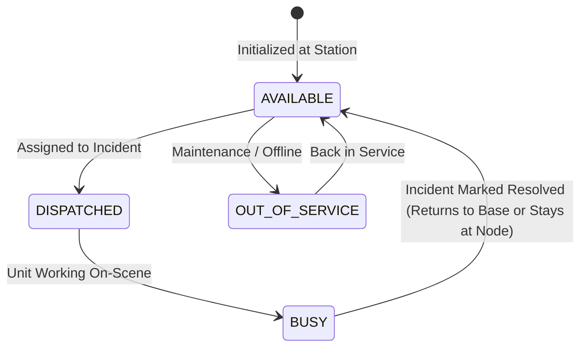
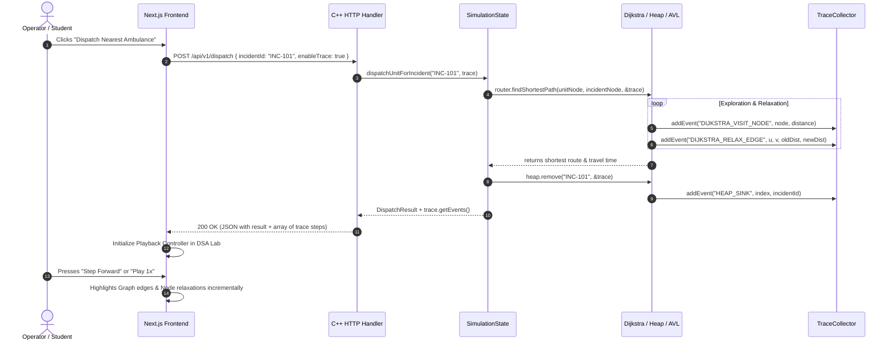

# EmergencyGrid — Architecture Blueprint

## 1. High-Level System Architecture

EmergencyGrid follows a **decoupled client-engine architecture** with a strict separation of concerns:
- **Presentation & Interaction Layer (Frontend)**: A Next.js (TypeScript + Tailwind CSS) single-page application handling command-and-control operations, interactive graph canvas rendering, state synchronization, and step-by-step DSA visualization playback.
- **Computation & Simulation Core (Backend)**: A high-performance, single-process C++20 engine that holds simulation state, executes manual data structure operations, calculates optimal dispatches, and streams detailed execution traces via a lightweight HTTP JSON API.

```mermaid
flowchart TB
    subgraph Frontend["Next.js Web Client (Localhost:3000)"]
        direction TB
        subgraph OperationsMode["Mode A: Operations Console"]
            Dashboard[Incident & Fleet KPI Dashboard]
            CityMap[Interactive City Graph Canvas]
            DispatchPanel[Incident Creator & Unit Dispatcher]
            RoadControls[Road Closure & Traffic Controls]
        end

        subgraph DSALab["Mode B: DSA Lab"]
            TracePlayer[Playback Controller (Step / Play / Pause)]
            GraphVisualizer[Dijkstra Pathfinding Visualizer]
            HeapVisualizer[Binary Heap Priority Queue Visualizer]
            AVLVisualizer[AVL Tree Index Visualizer]
            HashVisualizer[Hash Table Bucket Visualizer]
            ComplexityMetrics[Operation Counters & Big-O Notes]
        end

        StateClient[Frontend State Cache & API Client]
    end

    subgraph Backend["C++20 Simulation Core (Localhost:8080)"]
        direction TB
        HttpServer["Lightweight HTTP API Server (Crow / httplib)"]
        SimulationManager[Simulation State Manager]

        subgraph CoreEngine["Custom Data Structures & Algorithms Core"]
            GraphEngine["AdjacencyListGraph & DijkstraRouter"]
            PriorityEngine["BinaryHeap (Incident Priority Queue)"]
            AVLIndex["AVLTree (Incident Log by Timestamp/Severity)"]
            EntityHash["HashTable (Entity Lookups by ID)"]
            TraceCollector[Trace Event Collector / Logger]
        end
    end

    OperationsMode --> StateClient
    DSALab --> StateClient
    StateClient <===>|HTTP / JSON (REST)| HttpServer
    HttpServer --> SimulationManager
    SimulationManager --> CoreEngine
    CoreEngine --> TraceCollector
    TraceCollector -.->|Structured Traces in Response| HttpServer
```

---

## 2. Layer Responsibilities & System Boundaries

| System Layer | Primary Responsibilities | Strict Non-Responsibilities |
| :--- | :--- | :--- |
| **Next.js Frontend** | • Render UI, City Map, and DSA Visualizers<br>• Manage user interaction and animation timers<br>• Store recent trace batches in memory for playback<br>• Send user commands (add incident, close road, dispatch) | • **Never calculate routes or shortest paths**<br>• **Never rebalance trees or maintain client-side heaps**<br>• **Never author dispatch logic or decide unit assignment** |
| **C++ Engine** | • Maintain single authoritative simulation state<br>• Execute manual algorithms (Dijkstra, Heap, AVL, Hash)<br>• Enforce business rules (unit availability, road closures)<br>• Collect step-by-step trace events during execution | • **No UI rendering or HTML generation**<br>• **No persistent disk database (in-memory state with seed reload)**<br>• **No multi-client session management** |
| **HTTP API Interface** | • Validate request payload structure and IDs<br>• Serialize/deserialize C++ objects to JSON<br>• Provide predictable HTTP error status codes | • No business logic execution outside routing to engine |

---

## 3. Core Domain Entities & Relationships



---

## 4. Entity Lifecycle State Machines

### 4.1 Incident Lifecycle


### 4.2 Emergency Unit Lifecycle


---

## 5. Authoritative Simulation State Design

All mutable state lives inside a single thread-safe C++ class: `SimulationState`.

```cpp
class SimulationState {
public:
    // Core custom data structures
    AdjacencyListGraph cityGraph;               // Graph topology & live edge weights
    BinaryHeap<IncidentPriorityNode> pendingHeap;// Max-heap prioritizing pending emergencies
    AVLTree<string, IncidentRecord> incidentHistoryTree; // Balanced tree ordered by ID/timestamp
    HashTable<string, EmergencyUnit> unitTable;  // Fast O(1) lookup for responder units
    HashTable<string, IncidentRecord> activeIncidentTable; // Fast O(1) lookup for active calls

    // Global simulation metrics
    uint64_t currentSimulationTick{0};
    uint32_t totalIncidentsProcessed{0};
    uint32_t totalDispatchesCompleted{0};

    // State mutations (mutators emit trace events)
    Incident createIncident(const IncidentCreateRequest& req, TraceCollector& trace);
    DispatchResult dispatchUnitForIncident(const std::string& incidentId, TraceCollector& trace);
    bool updateRoadStatus(const std::string& roadId, bool isClosed, float congestion, TraceCollector& trace);
    bool completeIncident(const std::string& incidentId, TraceCollector& trace);
    void resetToSeedData();
};
```

### Invalidation & Stale Route Handling Policy:
When a road is closed or traffic conditions worsen:
1. **Pending Dispatches**: Evaluated at the exact moment of dispatch using current edge weights.
2. **In-Transit Dispatches**: If an active route is severed by a mid-response road closure, the simulation updates the assignment route by immediately re-running Dijkstra from the unit's last known intersection to the incident location. If no alternative path exists, the incident transitions to `BLOCKED_UNREACHABLE` and alerts the operator.

---

## 6. Trace-Event Architecture & Flow

Every algorithm in the core engine is instrumented with an optional `TraceCollector` reference. The trace collector records atomic, strongly-typed operations as they occur, without changing algorithm behavior or asymptotic complexity.

### 6.1 Trace Flow Sequence



### 6.2 Trace Performance Strategy
- In **Operations Mode**, callers pass `enableTrace = false`, causing `TraceCollector` to execute no-op stubs (zero allocation overhead).
- In **DSA Lab Mode**, `enableTrace = true`, pre-allocating an internal vector of events.
- Trace vectors are serialized directly into the HTTP response JSON payload, eliminating disk I/O and socket streaming complexity.

---

## 7. Directory Structure Blueprint

```text
EmergencyGrid/
├── docs/                               # Architecture, API & Algorithm documentation
│   ├── PROJECT_OVERVIEW.md
│   ├── ARCHITECTURE.md
│   ├── DATA_STRUCTURES_AND_ALGORITHMS.md
│   ├── API_CONTRACT.md
│   ├── IMPLEMENTATION_PLAN.md
│   └── DECISIONS_AND_ASSUMPTIONS.md
│
├── backend/                            # C++20 Simulation Core
│   ├── CMakeLists.txt                  # Build configuration
│   ├── include/
│   │   ├── core/
│   │   │   ├── types.hpp               # Common enums, structs, entity definitions
│   │   │   ├── config.hpp              # City presets, default weights
│   │   │   └── trace.hpp               # TraceEvent and TraceCollector definitions
│   │   ├── dsa/
│   │   │   ├── graph.hpp               # Custom AdjacencyListGraph
│   │   │   ├── dijkstra.hpp            # Custom DijkstraRouter with trace hooks
│   │   │   ├── binary_heap.hpp         # Custom templated BinaryHeap (min/max)
│   │   │   ├── avl_tree.hpp            # Custom self-balancing AVLTree
│   │   │   └── hash_table.hpp          # Custom HashTable with separate chaining
│   │   ├── simulation/
│   │   │   ├── state.hpp               # Authoritative SimulationState
│   │   │   ├── dispatch_engine.hpp     # Multi-criteria unit selector & router
│   │   │   └── seed_data.hpp           # Predefined MetroGrid-16 topology & fleet
│   │   └── api/
│   │       ├── router.hpp              # HTTP route declarations
│   │       └── serialization.hpp       # JSON request/response mappers
│   ├── src/
│   │   ├── core/trace.cpp
│   │   ├── simulation/state.cpp
│   │   ├── simulation/dispatch_engine.cpp
│   │   ├── api/router.cpp
│   │   └── main.cpp                    # HTTP Server entry point
│   └── tests/                          # C++ Unit & Integration Tests
│       ├── test_graph_dijkstra.cpp
│       ├── test_binary_heap.cpp
│       ├── test_avl_tree.cpp
│       ├── test_hash_table.cpp
│       └── test_dispatch_flow.cpp
│
└── frontend/                           # Next.js 14+ App Router Client
    ├── package.json
    ├── tsconfig.json
    ├── tailwind.config.ts
    ├── src/
    │   ├── app/
    │   │   ├── layout.tsx              # Shell & global navigation
    │   │   ├── page.tsx                # Operations Mode dashboard
    │   │   └── dsa-lab/
    │   │       └── page.tsx            # DSA Lab inspection view
    │   ├── components/
    │   │   ├── common/                 # Buttons, badges, modals, metric cards
    │   │   ├── operations/
    │   │   │   ├── CityMapCanvas.tsx   # Interactive SVG/Canvas graph renderer
    │   │   │   ├── IncidentQueue.tsx   # Priority triage table
    │   │   │   ├── FleetStatus.tsx     # Responder availability list
    │   │   │   └── RoadControlModal.tsx# Closure and congestion sliders
    │   │   └── dsa-lab/
    │   │       ├── TraceTimeline.tsx   # Scrub bar, speed control, step buttons
    │   │       ├── DijkstraGraphView.tsx# Visual node exploration canvas
    │   │       ├── BinaryHeapView.tsx  # Interactive tree & array visualizer
    │   │       ├── AVLTreeView.tsx     # Tree layout with balance factor indicators
    │   │       └── HashTableBucketView.tsx# Bucket chain inspect modal
    │   ├── lib/
    │   │   ├── api.ts                  # Typed client for C++ HTTP backend
    │   │   ├── types.ts                # TypeScript mirrors of backend entity schemas
    │   │   └── tracePlayer.ts          # State machine for playback stepping
    │   └── data/
    │       └── cityCoordinates.ts      # Visual canvas node coordinates
```
