# EmergencyGrid — Implementation Plan & Testing Blueprint

## 1. Phased Development Strategy

To balance rigorous algorithmic development with visible frontend progress, EmergencyGrid follows a **vertical-slice-first approach**. Rather than writing all data structures in isolation before touching the UI, we first deliver a thin, end-to-end operational loop (Phase 1 & 2), and then incrementally deepen the custom data structures, trace instrumentation, and DSA Lab visualizers.

```mermaid
gantt
    title EmergencyGrid Implementation Roadmap
    dateFormat  X
    axisFormat  Day %s

    section Phase 1: Environment & Engine Scaffold
    Core Types, Seed Topology, CMake setup    :p1, 0, 1
    Adjacency Graph & Dijkstra Core          :p1b, 1, 2

    section Phase 2: Vertical Slice (Operations Mode)
    HTTP API & Dispatch Endpoint             :p2, 2, 3
    Next.js UI, Map Canvas & Dispatch Card   :p2b, 3, 4

    section Phase 3: Priority Triage & Heaps
    Manual BinaryHeap Implementation         :p3, 4, 5
    Heap Trace Events & UI Visualizer        :p3b, 5, 6

    section Phase 4: AVL Tree & History Index
    Manual AVL Tree (Rotations & Balancing)  :p4, 6, 7
    AVL History Timeline & Rotation Player   :p4b, 7, 8

    section Phase 5: Hash Table & Resource Management
    Manual HashTable (Chaining & Rehash)     :p5, 8, 9
    DSA Lab Step-Through & Metrics Polish    :p5b, 9, 10

    section Phase 6: System Integration & Demo Prep
    Edge Case Testing & End-to-End Rehearsal :p6, 10, 11
```

---

## 2. Detailed Implementation Phases

### Phase 1: C++ Simulation Scaffold & Graph Routing Core
- **Scope**:
  - Set up backend build environment with CMake (C++20).
  - Define core data models: `Location`, `RoadSegment`, `Incident`, `EmergencyUnit`.
  - Implement deterministic "MetroGrid-16" static city topology in `seed_data.hpp`.
  - Implement manual `AdjacencyListGraph` and `DijkstraRouter` with edge weight computation ($T = \frac{L}{S} \cdot C$).
  - Implement basic `TraceCollector` recording visited nodes and relaxed edges.
- **Key Modules / Files**:
  - `backend/CMakeLists.txt`
  - `backend/include/core/types.hpp`, `backend/include/core/trace.hpp`
  - `backend/include/dsa/graph.hpp`, `backend/include/dsa/dijkstra.hpp`
  - `backend/include/simulation/seed_data.hpp`
  - `backend/tests/test_graph_dijkstra.cpp`
- **Dependencies**: None.
- **Acceptance Criteria**:
  - `test_graph_dijkstra` compiles and executes via CTest.
  - Finds correct optimal route from any node to any connected node on MetroGrid-16.
  - Dynamically routes around closed edges.
- **Pass Gate**: 100% pass on graph routing unit tests.

---

### Phase 2: Minimal End-to-End Vertical Slice (Operations Mode)
- **Scope**:
  - Integrate a lightweight single-header C++ HTTP server (Crow / `cpp-httplib`).
  - Expose `GET /api/v1/city/graph`, `GET /api/v1/simulation/state`, `POST /api/v1/incidents`, and `POST /api/v1/dispatch`.
  - Initialize Next.js project with Tailwind CSS and TypeScript.
  - Build `CityMapCanvas`: interactive SVG layout rendering intersections, roads, and active vehicle/incident pins.
  - Build `IncidentCreator` modal and basic `DispatchPanel` triggering real C++ Dijkstra dispatches.
- **Key Modules / Files**:
  - `backend/src/api/router.cpp`, `backend/src/main.cpp`
  - `frontend/src/app/page.tsx` (Operations Mode)
  - `frontend/src/components/operations/CityMapCanvas.tsx`
  - `frontend/src/lib/api.ts`
- **Dependencies**: Phase 1.
- **Acceptance Criteria**:
  - User can open `http://localhost:3000`, see the MetroGrid-16 layout, click an intersection to create an incident, click "Dispatch", and observe the shortest path highlighted across the map.
- **Pass Gate**: Working browser-to-C++ loop with real shortest route display.

---

### Phase 3: Incident Triage Engine & Binary Heap Visualizer
- **Scope**:
  - Implement custom `BinaryHeap<T>` in C++ (max-heap for incident triage, min-heap for distance ranking).
  - Implement priority calculation formula $(\text{Severity} \times 1000 + \text{WaitTime} \times 2)$ with deterministic tie-breaking.
  - Instrument `heap_push`, `heap_swim`, `heap_sink`, and `heap_extract` with trace events.
  - Expose `/api/v1/dsa/heap/snapshot` endpoint.
  - Build `BinaryHeapView` in Next.js showing synchronized array indices and visual binary tree diagram.
- **Key Modules / Files**:
  - `backend/include/dsa/binary_heap.hpp`
  - `backend/tests/test_binary_heap.cpp`
  - `frontend/src/components/dsa-lab/BinaryHeapView.tsx`
  - `frontend/src/app/dsa-lab/page.tsx`
- **Dependencies**: Phase 2.
- **Acceptance Criteria**:
  - Heap maintains invariant across 100 random insertions and deletions.
  - Deterministic tie-breaker selects earlier timestamp on equal priority.
  - Frontend visualizes swim/sink swaps step-by-step when an incident is inserted or extracted.
- **Pass Gate**: Heap unit tests pass; step-through animation verified in DSA Lab.

---

### Phase 4: Chronological Index & Self-Balancing AVL Tree
- **Scope**:
  - Implement custom pointer-based `AVLTree<Key, Value>` in C++.
  - Implement height calculation, balance factor computation, and 4 rotation routines (LL, RR, LR, RL).
  - Store resolved and active incidents in the AVL tree ordered by `(Timestamp, Severity)`.
  - Instrument node rotations and balance inspections with trace events.
  - Build `AVLTreeView` in Next.js showing tree topology, node heights, balance factors, and animated rotation pivots.
- **Key Modules / Files**:
  - `backend/include/dsa/avl_tree.hpp`
  - `backend/tests/test_avl_tree.cpp`
  - `frontend/src/components/dsa-lab/AVLTreeView.tsx`
- **Dependencies**: Phase 3.
- **Acceptance Criteria**:
  - Verified balance invariant: $|\text{BF}| \le 1$ for all nodes after arbitrary insertions and deletions.
  - Successful execution of all 4 rotation cases with accurate trace event emission.
- **Pass Gate**: AVL unit tests pass; rotation animations render properly.

---

### Phase 5: Entity Hash Table & DSA Lab Playback Suite
- **Scope**:
  - Implement custom `HashTable<Key, Value>` in C++ with DJB2 hashing and separate chaining.
  - Dynamic resizing (load factor $\ge 0.75$) with rehashing trace events.
  - Index all `EmergencyUnit` objects and `Incident` records by ID.
  - Build `HashTableBucketView` in Next.js showing bucket distribution and collision chain traversals.
  - Complete the unified `TraceTimeline` playback bar (Play, Pause, Step Forward, Step Backward, Speed Slider).
- **Key Modules / Files**:
  - `backend/include/dsa/hash_table.hpp`
  - `backend/tests/test_hash_table.cpp`
  - `frontend/src/components/dsa-lab/HashTableBucketView.tsx`
  - `frontend/src/components/dsa-lab/TraceTimeline.tsx`
  - `frontend/src/lib/tracePlayer.ts`
- **Dependencies**: Phase 4.
- **Acceptance Criteria**:
  - Hash table resolves collisions correctly without data loss.
  - Rehash triggers at load factor 0.75 and doubles capacity.
  - DSA Lab player smoothly steps through any algorithm trace emitted during operations.
- **Pass Gate**: All custom data structure tests pass; DSA Lab fully interactive.

---

### Phase 6: End-to-End System Integration, Verification & Polish
- **Scope**:
  - Connect dynamic road closure controls and congestion sliders to graph state.
  - Implement stale-route detection (recalculating active routes if a road closes).
  - Run comprehensive integration test suite.
  - Polish UI with dark mode, high-contrast route corridors, and clean typography.
  - Prepare and document the repeatable demo script.
- **Key Modules / Files**:
  - `backend/tests/test_dispatch_flow.cpp`
  - `frontend/src/components/operations/RoadControlModal.tsx`
  - `docs/DEMO_WALKTHROUGH.md`
- **Dependencies**: Phase 5.
- **Acceptance Criteria**:
  - Full demonstration script executes with zero crashes, zero desyncs, and complete reproducibility.
- **Pass Gate**: Flawless live demonstration execution.

---

## 3. Systematic Testing Matrix

| Component | Test Case Description | Expected Result | Pass Criteria |
| :--- | :--- | :--- | :--- |
| **Dijkstra** | Standard multi-hop shortest path | Correct path and minimum cumulative weight | Matches known manual calculation |
| **Dijkstra** | Graph with closed road segment | Router routes around closure or flags unreachable | Bypasses closed edge with higher-cost path |
| **Dijkstra** | Completely partitioned node | Destination unreachable from origin | Returns `UNREACHABLE`, emits no crash |
| **BinaryHeap** | Bulk insertion of varying severities | Highest priority always at root | Max-heap property verified across all nodes |
| **BinaryHeap** | Tie-breaking on equal priority score | Earlier timestamp extracts first | Deterministic order preserved |
| **AVLTree** | Sequential ascending keys (1, 2, 3, 4, 5) | Left rotations (RR) balance tree | Height $\le 1.44 \log_2(N)$, all $|\text{BF}| \le 1$ |
| **AVLTree** | Zig-Zag insertion (3, 1, 2) | Double rotation (LR) executes | Correct balance restored to root |
| **HashTable** | Inserting keys with deliberate hash collision | Elements chained in same bucket | Both keys recoverable via `find(key)` |
| **HashTable** | Insertion exceeding threshold $\lambda \ge 0.75$ | Capacity doubles, all items rehashed | Bucket count doubles; all keys accessible |
| **Fleet Engine** | Dispatch already assigned unit | Unit cannot be double-booked | Returns error or picks next best available unit |
| **Fleet Engine** | Incident completion | Unit status reverts to `AVAILABLE` | Unit becomes immediately re-eligible |
| **DSA Traces** | Consistency between Ops and Lab | Trace step count matches algorithm execution | Traces accurately mirror state transitions |

---

## 4. Repeatable 5-Minute Demonstration Scenario

To ensure a seamless, high-impact college presentation, the system is designed to run this deterministic demonstration:

1. **Step 1: System Baseline**:
   - Launch application on MetroGrid-16 seed topology.
   - Show 16 intersections, 26 road connections, and 9 emergency units stationed at 3 bases (EMS Base, Fire Station, Police Precinct).
2. **Step 2: Emergency Triage**:
   - Inject 3 simultaneous incidents with different severities:
     - Incident A: Medical emergency at J5 (Severity 2).
     - Incident B: Multiple-vehicle collision at J8 (Severity 5).
     - Incident C: Petty theft at J3 (Severity 1).
   - Switch to DSA Lab: inspect the `BinaryHeap` Max-Heap view. Point out how Incident B jumped to the root of the heap despite arriving second, due to the severity weighting formula.
3. **Step 3: Optimal Dispatch & Dijkstra Trace**:
   - Trigger dispatch for Incident B.
   - In DSA Lab, step through the `DijkstraRouter` trace: observe start node J1, tentative distance updates, edge relaxations, and the resulting optimal route (J1 $\rightarrow$ J4 $\rightarrow$ J8).
   - In Operations Mode, observe Fire Engine `ENG-01` dispatched and moving to `ON_SCENE`.
4. **Step 4: Dynamic Road Blockage & Route Recalculation**:
   - Close road segment `R4_8` (simulating fallen power lines).
   - Inject Incident D at J8.
   - Dispatch next available unit.
   - Show how the algorithm detects that `R4_8` is closed, explores alternative arterial routes via J6 $\rightarrow$ J7, and picks a detour path.
5. **Step 5: Historical Auditing in AVL Tree & Hash Table**:
   - Complete Incident B.
   - Show the resolution record indexed into the `AVLTree`.
   - Inspect the AVL Tree visualizer: note the balanced height and balance factors.
   - In the `HashTable` view, search for `"ENG-01"` to show $O(1)$ lookup and bucket chain resolution.
